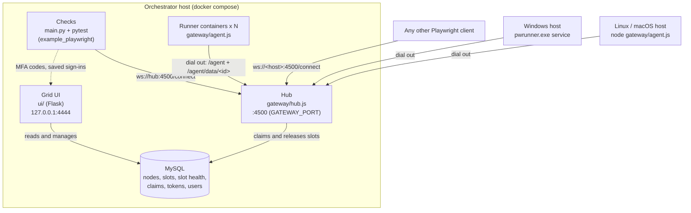
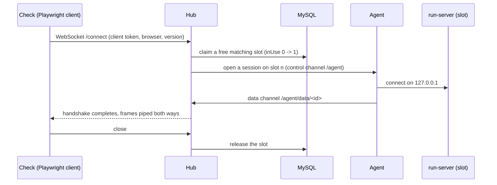

# playwright-remote-orchestrator

playwright-remote-orchestrator runs Playwright checks in containers and sends each run to a free browser slot on any number of runner hosts: Linux containers, Windows machines, anything that runs Node. Checks live in one place; the browsers run wherever you have capacity.

Runner hosts register themselves with a central **hub** and dial **out** to it, so the only port you open is the hub's, on the orchestrator host. Runner hosts open no inbound ports.

## Architecture

Every agent runs N `playwright run-server` slots on `127.0.0.1:3100..` and restarts any that crash.

## How a session is routed

1. A test connects to `ws://hub:4500/connect` with its client token. Playwright's connect already tells the hub which browser it wants and which Playwright version it is.
2. The hub picks a free slot on a node that offers that browser on the same Playwright version and claims it in MySQL. A slot is free when it is not in use, its node is connected, its run-server is healthy and it isn't [failing](concepts/slot-failures.md). While every matching slot is busy, the client waits.
3. The hub asks that node's agent to open a session; the agent connects to its local run-server and opens a data channel back to the hub, and the hub joins the two. When the session ends, the hub releases the slot.
4. Agents send a heartbeat with per-slot health every 10 s. After any disconnect or hub restart they reconnect and register again by themselves.

See [Routing and version matching](concepts/routing.md) for the details.

## Components

| Component | Where | Is |
| --- | --- | --- |
| Hub | `gateway/hub.js`, image `hub` | Accepts agents and clients on one port, routes each client to a slot, keeps claims in MySQL |
| Agent (Node) | `gateway/agent.js`, image `runner` | Runs the slots' `playwright run-server` processes on a runner host and dials out to the hub |
| pwrunner | `runner/` (Go) | The agent for Windows (and Linux) in one executable, with its installer, Windows service, status tool and uninstaller |
| Grid UI | `ui/` (Flask), image `grid-ui` | Management console: overview, activity, sessions, access tokens, MFA secrets, saved sign-ins, people and roles |
| Orchestrator | `main.py`, `src/`, image `checks` | Runs pytest checks on an interval and hands each the hub's address in `PW_WS_ENDPOINT` |
| Images and stack | `docker/`, `docker-compose*.yaml` | The Dockerfiles and the compose files that start the whole stack |

## Where to go next

- [Getting started](getting-started.md): the stack on one machine with docker compose.
- [Deployment](deployment/docker-compose.md): add runner hosts on [Linux with docker](deployment/linux-docker.md), [Linux or macOS without docker](deployment/linux-macos.md) or [Windows](deployment/windows.md).
- [Writing checks](writing-checks.md): connect Playwright from Python or JavaScript.
- [Security](security.md): what the grid protects, and how to harden it.
- [Configuration reference](reference/configuration.md): every variable and flag.

## Licensing

MIT No Attribution (MIT-0): see [LICENSE](https://github.com/Sam-H101/playwright-remote-orchestrator/blob/master/LICENSE). Use, change and share it however you like, in open or closed projects, without crediting it or including the license. It comes as is, without warranty, and its authors aren't liable for any claim or damages arising from it.

The third-party software the images and the Windows runner bundle (Node.js, Playwright, the browsers and the rest) keeps its own licenses.
